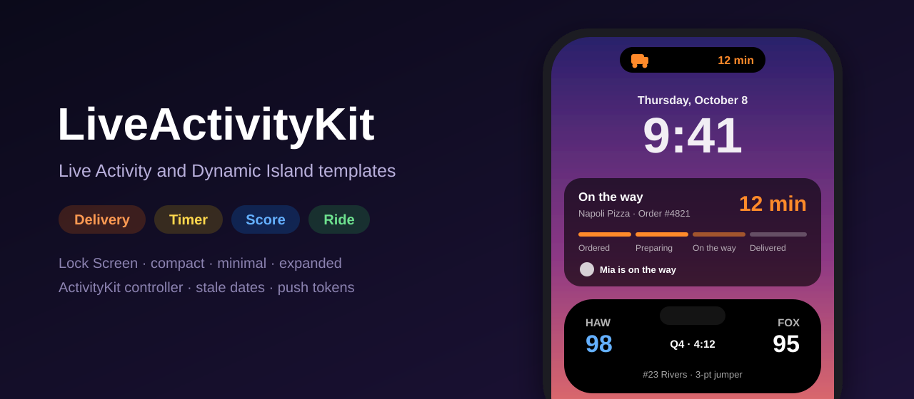
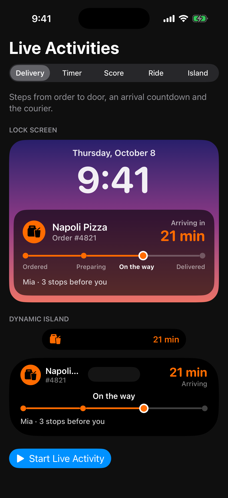
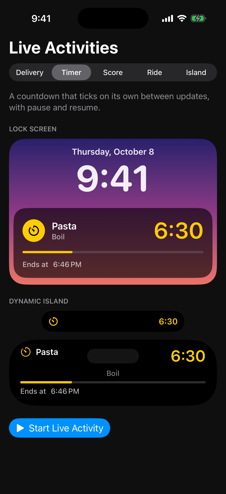
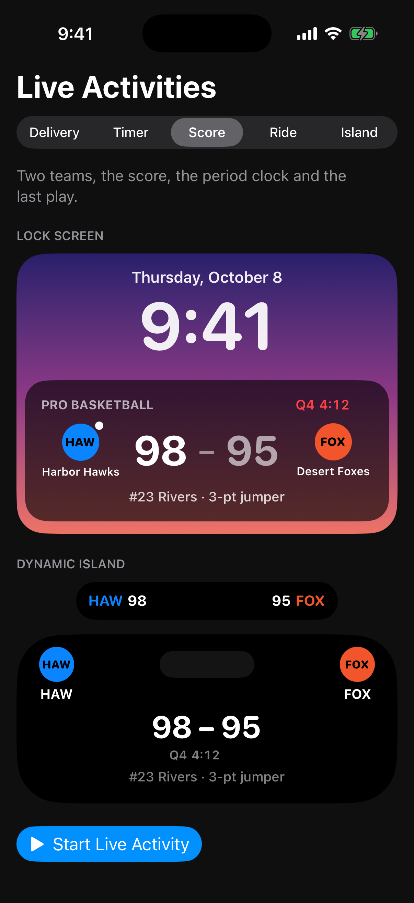
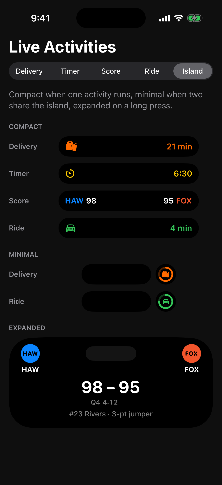

<p align="center">
  
</p>

<p align="center">
  <a href="https://github.com/halilozel1903/LiveActivityKit/actions/workflows/ci.yml"></a>
  
  
  
  
  
  <a href="LICENSE"></a>
</p>

**LiveActivityKit** gives you four ready-made **Live Activity** templates for SwiftUI (**delivery**, **timer**, **score** and **ride**), each with a Lock Screen view and every **Dynamic Island** presentation: compact, minimal and expanded. A small **ActivityKit controller** starts, updates and ends an activity with stale dates, skipped no-op updates and push tokens as hex, and the logic behind it is pure Swift that runs and is tested on the Mac. Drawn island previews let you show every presentation side by side in a gallery, in Xcode previews or in screenshots.

```swift
import LiveActivityKit

// In the widget extension: one line per template.
@main
struct Widgets: WidgetBundle {
    var body: some Widget {
        DeliveryLiveActivity()
        RideLiveActivity()
    }
}

// In the app: start, update and end.
let deliveries = ActivityController<DeliveryActivityAttributes>()
try deliveries.start(
    DeliveryActivityAttributes(merchant: "Napoli Pizza", orderNumber: "4821"),
    state: .init(stepIndex: 1, eta: .now + 25 * 60)
)
await deliveries.update(.init(stepIndex: 2, eta: .now + 12 * 60, courierName: "Mia"))
```

## Screenshots

Captured by CI from the example app's gallery on an iPhone simulator. CI cannot capture a real Live Activity, so the Lock Screen and Dynamic Island views you see here are the gallery's drawn previews (the package's preview views, rendering the same template views a running activity uses). The gallery's buttons start real Live Activities when you run the app yourself.

| Delivery | Timer |
| :---: | :---: |
|  |  |

| Score | Dynamic Island |
| :---: | :---: |
|  |  |

## Features

- **Four templates**: `DeliveryActivityAttributes` (steps from order to door, an ETA and the courier), `TimerActivityAttributes` (a countdown that ticks on its own, with pause and resume), `ScoreActivityAttributes` (two teams, the score, the period clock and the last play) and `RideActivityAttributes` (finding a driver, the pickup, the trip and the car to look for).
- **Every presentation**: each template draws the Lock Screen banner, the compact leading and trailing views, the minimal view and the four expanded regions, and shows a "waiting for an update" note once the content is stale.
- **One widget per template**: `DeliveryLiveActivity`, `TimerLiveActivity`, `ScoreLiveActivity` and `RideLiveActivity` are complete `ActivityConfiguration` widgets with a full `DynamicIsland` and the template's keyline tint. `LiveActivityTemplateWidget` does the same for your own templates.
- **ActivityController**: start, update and end with alerts and dismissal policies, a stale date on every update from `LiveActivityUpdatePolicy`, skipped updates when nothing visible changed, optional throttling, and `pushToken` as lowercase hex for your server.
- **Pure, testable logic**: step progress, ETA text, timer progress, score lines and scoring alerts, ride progress, stale dates, update decisions and push token encoding are plain Swift with no ActivityKit, tested with Swift Testing on macOS.
- **Drawn previews**: `compactPreview`, `minimalPreview`, `expandedPreview` and `lockScreenPreview` draw any template in a mock Dynamic Island or Lock Screen banner at real point sizes, and `.liveActivityNow(_:)` freezes countdowns for previews and screenshots.
- **Cross-platform**: everything behind ActivityKit is guarded with `#if canImport(ActivityKit) && os(iOS)`, so the package builds and its tests run on macOS 14. `InMemoryActivityBackend` stands in for ActivityKit in tests and previews.

## Installation

Add the package with Swift Package Manager. In Xcode choose **File › Add Package Dependencies…** and enter the repository URL, or add it to `Package.swift`:

```swift
dependencies: [
    .package(url: "https://github.com/halilozel1903/LiveActivityKit.git", from: "1.0.0")
]
```

Then add `LiveActivityKit` to **both** your app target (to start activities) and your widget extension (to draw them).

Live Activities also need:

1. `NSSupportsLiveActivities` set to `YES` in the app's Info.plist (`INFOPLIST_KEY_NSSupportsLiveActivities = YES` with a generated Info.plist).
2. A widget extension whose bundle includes the template widgets.

## Usage

### Show a template in your widget extension

```swift
import LiveActivityKit
import SwiftUI
import WidgetKit

@main
struct LiveActivityWidgets: WidgetBundle {
    var body: some Widget {
        DeliveryLiveActivity()
        TimerLiveActivity()
        ScoreLiveActivity()
        RideLiveActivity()
    }
}
```

### Start, update and end an activity

```swift
let rides = ActivityController<RideActivityAttributes>(
    policy: LiveActivityUpdatePolicy(maxAge: 600, minimumInterval: 5)
)

let attributes = RideActivityAttributes(pickup: "Ferry Building", destination: "Mission Dolores Park")
var state = RideActivityAttributes.ContentState(
    phase: .driverEnRoute, eta: .now + 240, distanceRemaining: 1_200, legDistance: 3_400,
    driverName: "Alex", vehicle: "White Toyota Prius", plate: "8KZM 214"
)

try rides.start(attributes, state: state, staleDate: attributes.staleDate(for: state, updatedAt: .now))

state.distanceRemaining = 600
let result = await rides.update(state)        // .sent, .unchanged, .throttled or .notRunning

await rides.end(state, dismissal: .after(.now + 15 * 60))
```

`start` throws `LiveActivityError.disabled` when the user turned Live Activities off, `.alreadyRunning` when the controller already runs one, and `.requestFailed` with ActivityKit's message otherwise. Every start and update gets a stale date `maxAge` ahead unless you pass one; once it passes, the templates show that they are waiting for an update.

### Alerts and push tokens

```swift
let games = ActivityController<ScoreActivityAttributes>()
try games.start(match, state: kickoff, pushUpdates: true)
games.onPushToken = { hex in
    Task { try await api.register(liveActivityToken: hex) }   // also in games.pushToken
}

// Lights up the screen and expands the island when a team scores.
let alert = match.scoreAlert(from: previous, to: latest)
await games.update(latest, alert: alert)
```

Push updates send the same `ContentState` JSON your server encodes; `ActivityTint` encodes as a hex string such as `"#FF6B00"`.

### Your own template

Conform your attributes to `LiveActivityTemplate` and draw each presentation; `LiveActivityTemplateWidget<YourAttributes>` then gives you the widget, and the preview helpers work as they do for the built-in templates.

```swift
struct ParkingAttributes: LiveActivityTemplate {
    var zone: String
    struct ContentState: Codable, Hashable, Sendable { var endDate: Date }

    var accentTint: ActivityTint { .teal }

    @MainActor @ViewBuilder
    static func makeView(attributes: Self, state: ContentState, presentation: LiveActivityPresentation, isStale: Bool) -> some View {
        switch presentation {
        case .compactLeading, .minimal: Image(systemName: "parkingsign")
        default: LiveActivityCountdown(to: state.endDate)
        }
    }
}

#if canImport(ActivityKit) && os(iOS)
import ActivityKit
extension ParkingAttributes: ActivityAttributes {}
#endif
```

### Previews and tests

```swift
#Preview {
    VStack(spacing: 16) {
        TimerActivityAttributes.compactPreview(pasta, state: boiling)
        TimerActivityAttributes.expandedPreview(pasta, state: boiling)
        TimerActivityAttributes.lockScreenPreview(pasta, state: boiling, isStale: true)
    }
    .liveActivityNow(fixedDate)   // countdowns read as of this date
}
```

In tests, `InMemoryActivityBackend` records every request, update and end and can hand out push tokens:

```swift
let backend = InMemoryActivityBackend<DeliveryActivityAttributes>()
let controller = LiveActivityController(backend: backend)
let id = try controller.start(attributes, state: state, pushUpdates: true)
backend.sendPushToken(Data([0xAB, 0xCD]), for: id)
backend.records.map(\.kind)   // [.request]
```

## Example app

`Example/` holds **LiveActivityDemo**, an iPhone app with a gallery of every template, and **LiveActivityWidgets**, a real widget extension that draws them. Each gallery page shows a template on a drawn Lock Screen and in the drawn compact and expanded Dynamic Island; the *Island* page shows every template in the island at once. The buttons under each template start, step and end a real Live Activity: lock the simulator to see it on the Lock Screen, or use an iPhone with a Dynamic Island.

The project uses [XcodeGen](https://github.com/yonaskolb/XcodeGen) so no project file has to live in the repo:

```bash
brew install xcodegen
cd Example && xcodegen generate
open LiveActivityDemo.xcodeproj
```

Launch with `-screenshot delivery|timer|score|island` to open one gallery page, as CI does for the screenshots above.

## Requirements

- Xcode 26 or later (Swift 6.2 toolchain)
- iOS 17+ for Live Activities and the widgets
- macOS 14+ for building the package and running its tests on the Mac

## Contributing

Issues and pull requests are welcome. Run `swift test` before opening a pull request; CI also builds the package for the iOS Simulator and builds the example app with its widget extension.

## License

LiveActivityKit is available under the MIT License. See [LICENSE](LICENSE) for details.
